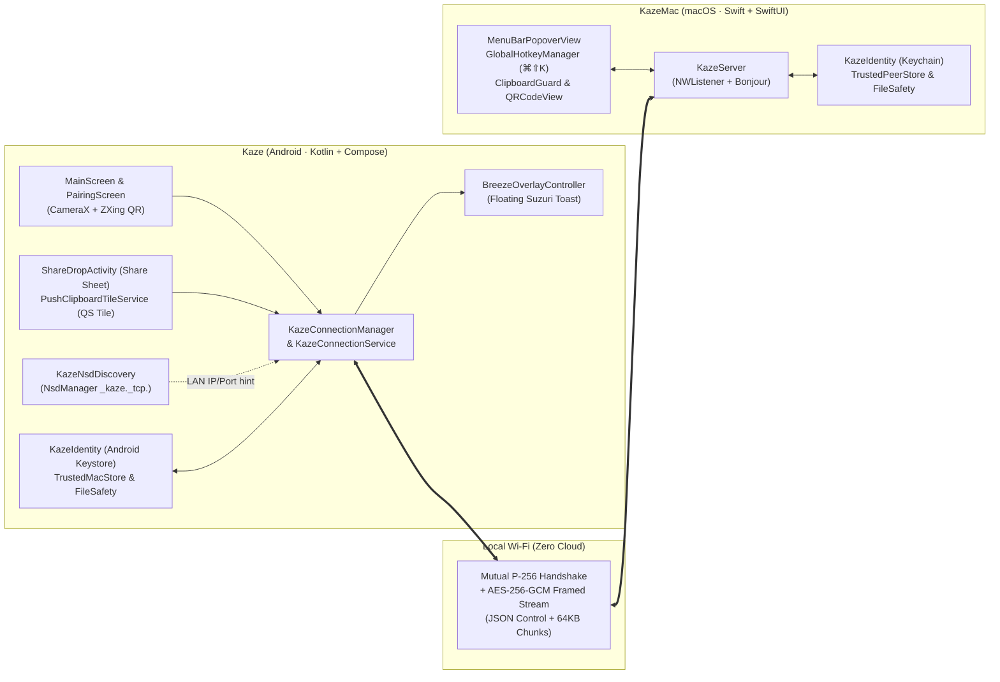
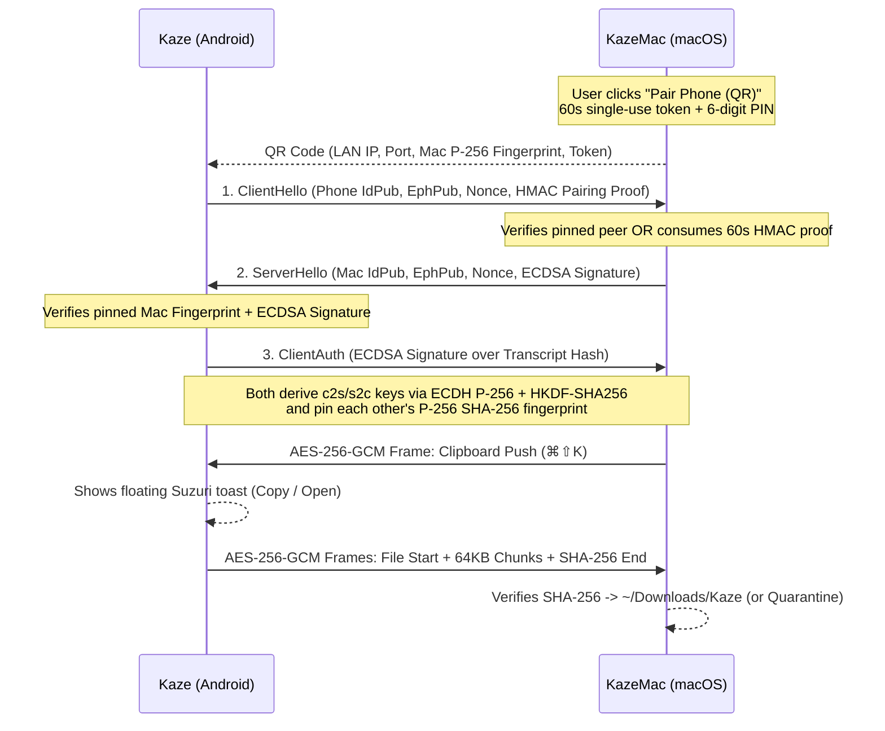

# Kaze (風) — Android Companion

A minimalist Android companion app for local-Wi-Fi, manual-push clipboard & quick file drops with your Mac ([KazeMac](https://github.com/rainyramen7/KazeMac)), crafted in the **Suzuri & Persimmon (柿)** dark inkstone aesthetic.

## Features

- **Manual Push Only:** Push your Android clipboard via 1 tap in-app, the **Quick Settings Tile**, or send photos/files/links directly from Android's **Share Sheet** (`Drop via Kaze`).
- **Floating Incoming Breeze Overlay:** Slides a translucent Suzuri toast over any app when you press `⌘⇧K` on your Mac, with explicit **Copy** / **Open** actions (never silently overwrites your clipboard).
- **Zero-Trust QR + 6-Digit PIN Pairing:** Offline CameraX + ZXing QR scanner with 6-digit PIN fallback and automatic `_kaze._tcp.` LAN discovery.
- **Hardware-Backed P-256 Security:** Device signing key lives in **Android Keystore**; paired Mac fingerprint is pinned in Keystore-encrypted storage. Every transfer runs over an ephemeral ECDH (P-256) + mutual ECDSA + HKDF-SHA256 + streaming AES-256-GCM tunnel.
- **Privacy & Safe Drops:** Honors `ClipDescription.EXTRA_IS_SENSITIVE` (Android 13+), keeps history in ephemeral RAM only, sets `allowBackup="false"` and `usesCleartextTraffic="false"`, sanitizes filenames into `Downloads/Kaze`, and quarantines executable/oversized files for confirmation.

## Architecture

Kaze runs entirely over your local Wi-Fi network with zero cloud servers. mDNS (`_kaze._tcp.`) is used only to locate your Mac's current LAN IP/port; all trust comes from pinned P-256 public keys.



### Pairing & Encrypted Transfer Flow



### Key Components

| Component | Path | Responsibility |
| :--- | :--- | :--- |
| **Crypto & Wire Codec** | `crypto/KazeCrypto.kt`, `crypto/KazeProtocol.kt` | Ephemeral P-256 ECDH, ECDSA signatures, HKDF-SHA256, AES-256-GCM framing, QR URI parser |
| **Hardware Identity** | `crypto/KazeIdentity.kt`, `net/TrustedMacStore.kt` | Android Keystore P-256 signing key & Keystore-encrypted pinned Mac store |
| **LAN Session & NSD** | `net/KazeConnectionManager.kt`, `net/KazeConnectionService.kt`, `net/KazeNsdDiscovery.kt` | Bonjour/mDNS lookup, persistent encrypted TCP session, chunked file I/O, MediaStore saving |
| **Entry & Overlay** | `overlay/BreezeOverlayController.kt`, `share/ShareDropActivity.kt`, `tile/PushClipboardTileService.kt` | Floating incoming toast, Android Share Sheet drop UI, Quick Settings manual push tile |
| **Suzuri UI** | `ui/theme/SuzuriTheme.kt`, `ui/components/WindBridgeCanvas.kt`, `ui/components/KakiMotif.kt` | Dark inkstone palette, animated wind-bridge canvas, persimmon motif, offline QR viewfinder |

## Building & Testing

```bash
./gradlew testDebugUnitTest assembleDebug
adb install -r app/build/outputs/apk/debug/app-debug.apk
```
